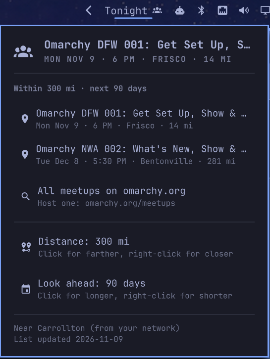
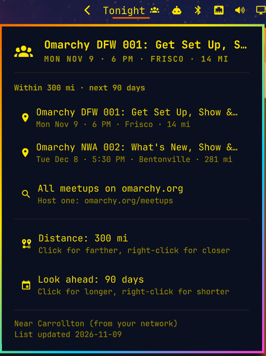

# Omarchy Meetups

The next [Omarchy meetup](https://omarchy.org/meetups/) near you, in your bar. Pick how far you're
willing to go (300 miles by default) and how far ahead to look (90 days), and the widget shows
how soon the next meetup in range is ("Tonight", "Tomorrow", "in 3 days"). Hover for its name and
time; click it for every upcoming meetup in range, each one a click from its sign-up page.


```bash
omarchy plugin add https://github.com/Gleasonmt/omarchy-meetups --enable
```

## What it looks like

The list, with the distance and look-ahead you can change right there. It wears whatever theme
you're using:

| Tokyo Night | Another theme |
|---|---|
|  |  |

What the bar shows:

| When | Bar |
|---|---|
| Happening right now | Now |
| Today, from 5 PM | Tonight |
| Today, before 5 PM | Today |
| Tomorrow | Tomorrow |
| 2–13 days away | in 3 days |
| 2 weeks or more | in 4 wks |
| Nothing in range | the icon, dimmed |

## How it works

- **Meetups** come from omarchy.org's own list, which it refreshes from the
  [Omarchy Luma calendar](https://luma.com/omarchy). The widget downloads it at most every six
  hours into `~/.cache/gleasonmt-meetups/` and shares that copy across every monitor.
- **Your location** is the one Omarchy's Weather panel already uses: the place you set there
  (`omarchy-weather-location`), or, with none set, the city
  [geo.omarchy.org](https://geo.omarchy.org/) places your network in, the same lookup the
  Weather panel makes. Change it in the Weather panel and the meetups follow. Nothing else
  leaves your computer.
- **Times** are shown in your own time zone.

## Dependencies and network

Everything it needs comes with Omarchy: `curl` and `bash` to fetch, `omarchy-launch-browser` to
open links, and `omarchy-bar` to save the settings you change in the panel. It makes two kinds of
request, both plain HTTPS GETs:

- `raw.githubusercontent.com/omacom/omarchy-site/master/src/data/meetups.json`, omarchy.org's
  meetup list, at most every six hours
- `geo.omarchy.org`, only when no Weather location is set, at most once a day

Both answers are read as JSON and nothing downloaded is ever run.

## Settings

**Distance** and **Look ahead** are at the bottom of the widget's list: click to step up through
common values, right-click to step back (or use the arrow keys). Everything can also be set from a
terminal with `omarchy bar set`, and the widget updates right away:

```bash
omarchy bar set gleasonmt.meetups radius 150   # distance
omarchy bar set gleasonmt.meetups days 30      # how far ahead
omarchy bar set gleasonmt.meetups unit km
```

They're stored on the widget's entry in `~/.config/omarchy/shell.json`, which you can also edit by hand:

| key | default | |
|---|---|---|
| `radius` | `300` | how far to look |
| `days` | `90` | how many days ahead to look (7–365) |
| `unit` | `mi` | `mi` or `km` |
| `includeOnline` | `false` | also list online meetups |
| `hideWhenNone` | `false` | hide the widget when nothing is in range |

Click the widget to open the list, middle-click to refresh it now. In the list, the arrow keys
move, Enter opens a meetup, and `r` refreshes. For a keybinding:
`omarchy-shell gleasonmt.meetups toggle`.

## Removing

```bash
omarchy plugin remove gleasonmt.meetups
rm -rf ~/.cache/gleasonmt-meetups
```

## Development

The logic lives in `Model.js` and is tested under Node:

```bash
node --test tests/*.test.mjs
```

## License

MIT. Meetup listings belong to their hosts and come from omarchy.org.
